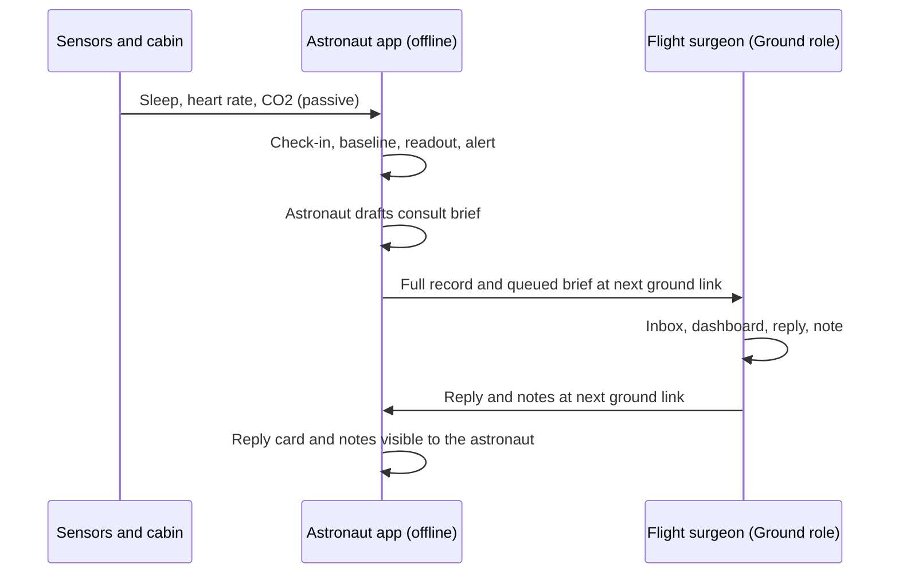

# User flow: how the astronaut and the flight surgeon use Own Your Baseline

Goal: the astronaut spends **under a minute a day** and still gets something useful every time they open the app. This page describes the daily use for both roles, not the demo feature list. The idea itself: `docs/IDEAS.md`. Requirements: `docs/REQUIREMENTS.md`. Research behind it: `docs/research/astronaut-health-problems.md` (16-hour workdays, tedious procedures, fear of grounding, conflict with ground).

All numbers marked "demo parameter" are our choices for the prototype, not medical values. Thresholds need a citation or that label (CLAUDE.md, rule 7).

## Flow at a glance

**Astronaut, normal day (under 1 minute):**

1. Wakes up. Sensors already recorded sleep and heart rate.
2. Opens the check-in, taps "Same as yesterday" or answers 4 quick questions.
3. Reads today's readout: "All in your usual range" plus one tip. Done.

**Astronaut, day with an alert (up to 3 minutes):**

1. The readout shows one alert: what changed, one next step, when to contact the flight surgeon.
2. Does the next step. Measures something only if the app asks and says why.
3. Optionally taps "Ask the flight surgeon": the brief is drafted, they accept or edit the question and send.
4. The app follows up on its own and closes the alert when things return to normal.

**Flight surgeon, after each ground link:**

1. The astronaut's full record arrives, with the last-sync time shown.
2. Opens the inbox: briefs first, then new alerts.
3. Replies, adds a note, sets a watch flag or requests a measurement, opening the astronaut's dashboard when context is needed.
4. Everything written goes up at the next link and appears in the astronaut's app word for word.

The sections below give the details.

## Design principles

1. **The app does the work, not the astronaut.** Heart rate, sleep and cabin CO2 arrive passively. The astronaut is never asked to type something a sensor already knows.
2. **One short touch a day.** A morning check-in of 4 taps, with a "Same as yesterday" button that finishes it in one.
3. **Every touch pays back.** After each check-in or measurement the app shows one plain-language line: what it noticed and one thing to try. Never an empty "thanks".
4. **Silence means fine.** No news is good news. No notification, badge or alert on a normal day.
5. **Ask for a measurement only when it changes the advice.** Blood pressure, glucose and temperature are not daily chores. The app asks for them on a weekly slot or when a drift makes them useful, and says why.
6. **Close the loop for the astronaut.** After an alert the app follows up itself, using passive data, and tells the astronaut when it is resolved.
7. **Asking ground is two taps.** The app drafts the consult brief with the related items pinned, the astronaut accepts or edits the question and sends it.
8. **No penalty for honesty or skipping.** Streaks and points count completed check-ins, never good health values. Reporting a symptom never lowers a score. Skipping a day shows no guilt message.
9. **Nothing hidden either way.** The flight surgeon sees the full record. The astronaut sees everything the flight surgeon sees, including notes, flags and assessments. No reporting work for the astronaut: ground already has the data.

## Effort budget

| Situation | Astronaut effort | What they get |
|---|---|---|
| Normal day | 10 to 30 seconds (check-in) | Today's readout: status at a glance, one tip |
| Day with an alert | Up to 3 minutes | What changed, one next step, when to call the flight surgeon, optional brief to ground |
| Weekly measurement slot | About 5 minutes (BP, glucose, temperature) | Updated baseline, weekly summary |
| Anything else | 0 | Passive tracking keeps running, follow-ups happen on their own |

## Who uses it

| Role | What they do | What they see |
|---|---|---|
| Astronaut (main user) | Check-in, read readout, act on tips, ask questions | Everything about themselves, plus every note, flag and reply from ground |
| Flight surgeon (ground) | Reviews the record, answers briefs, writes notes | The astronaut's full record, synced at each ground link. Everything they write is visible to the astronaut |
| Commander (optional, S3) | Plans workload | Readiness status per person, not raw medical data. The astronaut sees what the commander sees about them |

## Device

Recommendation (record the final choice in `docs/DECISIONS.md`): one responsive web app. Wrist wearable gives heart rate and sleep. The astronaut uses a crew tablet, and the check-in also fits a phone-sized screen (390x844 designs). Large targets for gloves and microgravity: 56px primary buttons, 44px minimum.

## First week: learning the baseline

Day 0, about 2 minutes, once:

1. Short welcome: "Your flight surgeon sees the same health record you do, and you see everything they write about you." Decision-support footer is visible from the first screen.
2. Confirm the wearable is connected. No forms, no medical history typing.
3. First check-in.

Days 1 to 7 (demo parameter: 7 days):

- Cards show "Learning your baseline: day 3 of 7" instead of a status color.
- The OSD-569 Earth reference range is shown as reference only.
- No drift alerts yet. Only safety thresholds with a cited source can raise an alert in this period.
- Benefit already on day 1: sleep and heart-rate trends, body map explainers, how-to guides for each measurement.

## A normal day

| When | Trigger | Astronaut does | Time | App gives back |
|---|---|---|---|---|
| Wake-up | Gentle reminder in the post-sleep slot of the schedule | Opens check-in. Taps "Same as yesterday", or answers 4 questions | 10 to 30 s | Today's readout |
| During the day | Nothing | Nothing | 0 | Passive tracking of heart rate, sleep, CO2 |
| Each ground link | Automatic | Nothing | 0 | Record syncs to ground and is listed in the sync log. New notes from the surgeon appear |
| Any time a symptom appears | Astronaut's choice | Taps a body region on the map, picks how strong (mild, moderate, strong) | 5 s | Explainer for that region, one tip, when to call the flight surgeon |
| Evening | Nothing | Optional glance at the dashboard | 0 to 30 s | Status cards, 7-day trends |

### Morning check-in (4 steps or fewer)

One question per screen, large segmented buttons, progress bar, "about 20 s left".

1. How rested do you feel? (sleep hours already come from the wearable and are shown, not asked)
2. Headache? None, mild, moderate, strong.
3. Mood? 5 faces with words.
4. Any change in vision? No, yes.

"Same as yesterday" on the first screen finishes it in one tap. Any step can be skipped.

### Today's readout (right after the check-in)

One screen, readable in 5 seconds:

- Overall: "All in your usual range" with circle icon, or "1 thing worth checking" with triangle icon.
- One line about the strongest change, in plain words. Example: "You slept 1.2 h less than your usual for 3 nights."
- One tip. Example: "Try moving screen time out of the hour before sleep."
- Footer: "Decision support, not a diagnosis." and "Simulated data" where it applies.

## A day with an alert

Rules (demo parameters unless cited):

- At most one alert per day, the most important one. Others wait in the dashboard's "Worth checking" card.
- Every alert compares with the astronaut's own baseline, not Earth ranges.
- Every alert has three parts: what changed, one next step, "Contact the flight surgeon if...".

Flow:

1. **Alert in the readout.** Example: "Headaches on 2 of the last 3 days. Cabin CO2 was above your module's usual level on those days. This is a pattern to check, not a cause." Next step: "Ask for a ventilation check and take a break in a better-ventilated module." Contact the flight surgeon if: "headache is strong, or comes with vision changes."
2. **Optional measurement, only if useful.** "A temperature reading would help tell this apart from a fever. About 1 minute. Measure now or later?" One tap opens the how-to guide.
3. **Optional brief to ground (two taps).** Button "Ask the flight surgeon". The app drafts:
   - the items related to this alert pinned at the top (headache days, CO2 trend), so the surgeon looks there first. The surgeon still sees the full record;
   - a suggested question the astronaut can edit: "Is this pattern something to watch, or should I change anything?";
   - a "What ground sees" link that opens the same record as it appears on the surgeon's screen.
   The astronaut checks it and taps "Send at next ground link". The brief is queued and listed in the sync log (D6).
4. **Follow-up without effort.** The app watches the next days' check-ins and CO2. When the pattern stops it says so in the readout: "No headaches for 2 days since CO2 went down. Alert closed." The astronaut can also close it by hand.

## Reply from ground

- The flight surgeon's reply arrives with the next ground link and appears as a card in the app, linked to the brief it answers.
- The reply is advice to a colleague, not an order. The astronaut can mark it "Done" or "Ask a follow-up".
- Offline or delayed link: the brief shows "Queued, will send at next link". Nothing is lost.
- Surgeon notes: anything the surgeon writes about the astronaut (notes, flags, assessments) appears in the astronaut's app with the same wording. There is no ground-only field.

## Flight surgeon flow (Ground role)

The flight surgeon works in the same app, switched to the "Ground" role (requirement D7). In the demo both roles run against the same local API on the station server; the ground link is simulated by the API (see `docs/TEAM.md`).

### How data reaches the surgeon

1. Everything is recorded on board, on the station server, with no Earth link needed.
2. At each ground link the full record syncs to ground: passive data, check-ins, symptom logs, alerts, queued briefs. The astronaut's sync log lists each sync.
3. Data on the ground side is as of the last link, not live. Every ground screen shows "Last sync: day 10, 14:20" so the surgeon never mistakes old data for current. The delay depends on the mission (station, Moon, Mars).

### What the surgeon sees

| Screen | What is on it |
|---|---|
| Crew list | One row per astronaut: overall status (icon, word, color), open alerts, unanswered briefs, last sync time |
| Astronaut dashboard | The same dashboard the astronaut sees: body map, six indicator cards with trends and personal baseline, OSD-569 card, Cabin Link, alerts and their follow-up state |
| Inbox | Briefs first (question on top, pinned items under it), then alerts raised since the last sync |

Yes, the surgeon has the full dashboard. It is the same dashboard, built from the same record, so the astronaut and the surgeon always look at the same picture.

### What the surgeon can do

- **Reply to a brief.** Advice to a colleague, not an order.
- **Add a note to any item** (for example on the sleep card: "Expected after the schedule shift, recheck on day 13").
- **Set a watch flag** on an indicator, with a reason.
- **Request a measurement** with a reason ("Temperature on day 11, to rule out fever"). The astronaut sees it as a request with the reason and does it when it fits their day.

The surgeon cannot edit the astronaut's data, change thresholds silently or change the crew schedule from this app.

Everything the surgeon writes is queued and goes up at the next link. On the astronaut's side it appears with the same wording, the surgeon's name and the time. There is no ground-only field.

### A surgeon's routine

1. After each ground link: open the inbox.
2. Answer briefs first, then look at new alerts.
3. Open an astronaut's dashboard only when something needs context.
4. Write a note or request a measurement if needed. Done.

Normal days need no action from the surgeon either: no alerts and no briefs means an empty inbox.

## Weekly slot (about 5 minutes)

Placed in an existing schedule slot (for example after the weekly exercise session):

1. Blood pressure, glucose and temperature, each with a short how-to guide and the reason it matters.
2. Weekly summary on one screen: trends against the personal baseline, check-in streak, anything that changed, blood count card with the OSD-569 Earth reference range.
3. The summary syncs to ground with the rest of the record. Optional: attach a question through the brief flow.

## What the astronaut never has to do

- Type values a sensor already measures.
- Fill long forms or a medical history.
- Read a dashboard to find out if they are fine. The readout tells them.
- Remember to check whether an alert went away.
- Write reports for ground. Ground already sees the record. The astronaut asks questions only when they want to.
- Wonder what ground thinks about them. Every note and flag is in their app.
- Fear that a reported symptom lowers their score.

## Demo story (one astronaut, 14 simulated days)

Tell the demo as one mission, not a feature list. Matches the simulated data plan in `docs/REQUIREMENTS.md`.

| Day | What happens | Shown in the demo |
|---|---|---|
| 1 to 7 | Baseline is learned | "Learning your baseline" cards, one-tap check-in |
| 8 | Normal day | "Same as yesterday", readout: all in usual range |
| 9 | Cabin CO2 rises | Nothing for the astronaut to do, passive data |
| 10 | Headache in check-in | Alert with CO2 pattern, next step, contact-surgeon line |
| 10 | Astronaut asks ground | Drafted brief with pinned items, send |
| 10 to 11 | Ground link | Switch to the Ground role: the surgeon sees the full record and the question, writes a note and a reply |
| 11 | Reply arrives | Reply card and the surgeon's note in the astronaut's app: same picture on both ends |
| 12 | CO2 back down, no headache | Follow-up: "Alert closed" |
| 14 | Weekly slot | BP, glucose, temperature entry, weekly summary with OSD-569 card |
| Any | Network off | Everything above still works |

## Requirements from this flow

The features this flow needs are in `docs/REQUIREMENTS.md`, section "Must (user flow)" and "Should (user flow)".
